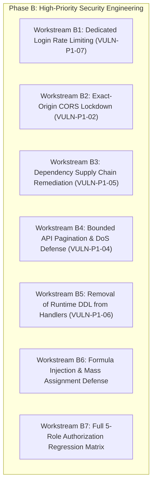

# Phase B Security Remediation Implementation Plan
# CHRIST (Deemed to be University) IQAC Platform

> **Document Type:** Implementation-Ready Security Engineering Plan  
> **Prepared By:** Senior Application Security Engineer & DevSecOps Architect  
> **Target System:** CHRIST University IQAC Platform  
> **Prerequisite:** Phase A Independently Verified & Closed (70 Passing Automated Tests)  
> **Phase B Focus:** Identity & Network Defenses, Supply Chain, API Resiliency, and Schema Decoupling  
> **Guiding Principle:** Zero disruption to existing IQAC workflows, zero unnecessary architectural changes.  

---

## 1. Executive Summary & Objective

Phase A eliminated all four critical (P0) security vulnerabilities: public `/clear-all` routes, hardcoded credentials, department isolation bypasses, and unauthenticated database wipes.

Phase B addresses the **remaining five High-Priority (P1) findings** identified during the independent security audit, along with high-priority API resiliency and data confidentiality controls. Completing Phase B is a mandatory prerequisite for opening the production security release gate.

### Phase B Scope Overview



---

## 2. Workstream Details & Implementation Specifications

### Workstream B1: Dedicated Login Rate Limiting & Credential-Stuffing Defense
* **Vulnerability Reference:** `VULN-P1-07` (OWASP A07:2021 Identification & Authentication Failures)
* **Problem Statement:** The current server configuration applies only a permissive global rate limiter (10,000 requests per 15 minutes) across the entire application. An attacker can execute automated credential stuffing and brute-force dictionary attacks against `POST /api/auth/login` without being throttled.
* **Affected Files:**
  - [`src/app/backend/routes/auth.js`](file:///c:/mervin/Academics/christ/projects/IQAC/IQAC-Platform/src/app/backend/routes/auth.js)
  - [`src/app/backend/controllers/authController.js`](file:///c:/mervin/Academics/christ/projects/IQAC/IQAC-Platform/src/app/backend/controllers/authController.js)
* **Remediation Specification:**
  1. Configure dedicated `express-rate-limit` instance for authentication:
     ```javascript
     const authLimiter = rateLimit({
       windowMs: 15 * 60 * 1000, // 15 minutes
       max: 5, // 5 failed attempts per window
       standardHeaders: true,
       legacyHeaders: false,
       skipSuccessfulRequests: true, // Only count failed logins
       message: {
         success: false,
         code: 'AUTH_RATE_LIMITED',
         message: 'Too many failed login attempts from this IP. Please try again after 15 minutes.'
       }
     });
     ```
  2. Attach `authLimiter` strictly to `POST /api/auth/login`.
  3. Ensure failed attempts log an audit event via `logActionSafe()` with `action: 'LOGIN_RATE_LIMIT_EXCEEDED'`.
* **Testing Strategy:** Supertest burst of 6 rapid failed logins; assert 6th request returns HTTP 429 Too Many Requests.

---

### Workstream B2: Exact-Origin CORS Lockdown
* **Vulnerability Reference:** `VULN-P1-02` (OWASP A05:2021 Security Misconfiguration)
* **Problem Statement:** [`src/app/backend/server.js:46-52`](file:///c:/mervin/Academics/christ/projects/IQAC/IQAC-Platform/src/app/backend/server.js#L46-L52) utilizes regex wildcard matching (`/\.vercel\.app$/`, `/\.onrender\.com$/`). Any malicious third-party tenant hosted on Vercel or Render can issue cross-origin requests with credentials (`credentials: true`), stealing session tokens and institutional data.
* **Affected Files:**
  - [`src/app/backend/server.js`](file:///c:/mervin/Academics/christ/projects/IQAC/IQAC-Platform/src/app/backend/server.js#L44-L58)
* **Remediation Specification:**
  1. Completely remove wildcard regex matching.
  2. Build an explicit, strict origin whitelist sourced from environment variables:
     ```javascript
     const allowedOrigins = [
       process.env.CLIENT_URL,
       'https://iqac.christuniversity.in',
       'https://iqac-platform.vercel.app' // Specific production frontend deployment
     ].filter(Boolean);

     if (process.env.NODE_ENV !== 'production') {
       allowedOrigins.push('http://localhost:3000', 'http://127.0.0.1:3000');
     }

     const corsOptions = {
       origin: function (origin, callback) {
         if (!origin || allowedOrigins.includes(origin)) {
           callback(null, true);
         } else {
           callback(new Error(`CORS Policy Violation: Origin ${origin} not permitted.`));
         }
       },
       credentials: true,
       methods: ['GET', 'POST', 'PUT', 'DELETE', 'OPTIONS'],
       allowedHeaders: ['Content-Type', 'Authorization', 'X-Requested-With']
     };
     ```
* **Testing Strategy:** Supertest request with `Origin: https://evil-attacker.vercel.app` must be rejected with CORS error.

---

### Workstream B3: Vulnerable Dependency Remediation
* **Vulnerability Reference:** `VULN-P1-05` (OWASP A06:2021 Vulnerable and Outdated Components)
* **Problem Statement:** Backend and frontend dependencies contain known high-severity vulnerabilities:
  - `proxy-addr` (High severity — spoofable client IP addresses leading to IP rate limit bypass).
  - `tar` (High severity — arbitrary file overwrite).
  - `braces` (High severity — uncontrolled resource consumption / ReDoS).
* **Affected Files:**
  - `src/app/backend/package.json`
  - `src/app/backend/package-lock.json`
* **Remediation Specification:**
  1. Update direct dependencies in `src/app/backend/package.json` to secure versions.
  2. Execute `npm update` and resolve transitive dependencies via npm overrides or resolutions if necessary.
  3. Validate that `npm audit` reports zero critical and zero high-severity vulnerabilities.
* **Testing Strategy:** Execute test suite on updated dependency tree; ensure zero functional regressions.

---

### Workstream B4: Bounded API Pagination & DoS Defense
* **Vulnerability Reference:** `VULN-P1-04` (OWASP A04:2021 Insecure Design / Resource Exhaustion)
* **Problem Statement:** Listing endpoints across `Student`, `Faculty`, `Publication`, `Patent`, and `Placement` controllers execute unbounded `findAll()` queries. As institutional datasets grow to tens of thousands of records, single API requests consume hundreds of megabytes of RAM, starving the Node.js event loop and inducing Denial of Service.
* **Affected Files:**
  - [`src/app/backend/controllers/studentController.js`](file:///c:/mervin/Academics/christ/projects/IQAC/IQAC-Platform/src/app/backend/controllers/studentController.js)
  - [`src/app/backend/controllers/facultyController.js`](file:///c:/mervin/Academics/christ/projects/IQAC/IQAC-Platform/src/app/backend/controllers/facultyController.js)
  - [`src/app/backend/controllers/publicationController.js`](file:///c:/mervin/Academics/christ/projects/IQAC/IQAC-Platform/src/app/backend/controllers/publicationController.js)
  - [`src/app/backend/controllers/placementController.js`](file:///c:/mervin/Academics/christ/projects/IQAC/IQAC-Platform/src/app/backend/controllers/placementController.js)
* **Remediation Specification:**
  1. Implement a standardized pagination helper `src/app/backend/utils/paginationHelper.js`:
     ```javascript
     exports.getPagination = (req, defaultLimit = 50, maxLimit = 100) => {
       const page = Math.max(1, parseInt(req.query.page, 10) || 1);
       const limit = Math.min(maxLimit, Math.max(1, parseInt(req.query.limit, 10) || defaultLimit));
       const offset = (page - 1) * limit;
       return { page, limit, offset };
     };
     ```
  2. Use `findAndCountAll({ where, limit, offset, order })`.
  3. Return backwards-compatible JSON schema:
     ```json
     {
       "success": true,
       "count": 50,
       "pagination": { "total": 1250, "page": 1, "limit": 50, "totalPages": 25 },
       "data": [ ... ]
     }
     ```
  4. Preserve existing frontend table views (frontend already binds to `res.data.data` or `res.data`).
* **Testing Strategy:** Supertest call with `?limit=500` capped at 100 records; pagination metadata accurately reflected.

---

### Workstream B5: Removal of Runtime Schema-Altering DDL from Request Handlers
* **Vulnerability Reference:** `VULN-P1-06` (OWASP A01:2021 Broken Access Control / Integrity Failure)
* **Problem Statement:** During bulk upload, [`src/app/backend/controllers/facultyController.js:87-90`](file:///c:/mervin/Academics/christ/projects/IQAC/IQAC-Platform/src/app/backend/controllers/facultyController.js#L87-L90) and [`studentController.js:255-265`](file:///c:/mervin/Academics/christ/projects/IQAC/IQAC-Platform/src/app/backend/controllers/studentController.js#L255-L265) execute raw SQL statements like:
  ```sql
  ALTER TABLE "faculties" DROP CONSTRAINT IF EXISTS faculties_employeeId_key;
  ```
  Executing DDL statements inside HTTP request handlers causes exclusive table-level locks, deadlocks concurrent queries, and creates serious privilege vulnerabilities.
* **Affected Files:**
  - [`src/app/backend/controllers/facultyController.js`](file:///c:/mervin/Academics/christ/projects/IQAC/IQAC-Platform/src/app/backend/controllers/facultyController.js#L80-L110)
  - [`src/app/backend/controllers/studentController.js`](file:///c:/mervin/Academics/christ/projects/IQAC/IQAC-Platform/src/app/backend/controllers/studentController.js#L240-L280)
* **Remediation Specification:**
  1. Completely remove all `ALTER TABLE` queries from request handlers.
  2. Implement upsert semantics using Sequelize transactions:
     - For Students: Query existing `registerNumber` records in batch, execute updates on existing rows and bulk create new records.
     - For Faculty: Upsert on `employeeId`.
  3. Ensure all bulk modifications run within an atomic `sequelize.transaction()`.
* **Testing Strategy:** Execute concurrent bulk uploads; verify zero table locks and zero DDL operations dispatched.

---

### Workstream B6: Formula Injection & Mass Assignment Defense
* **Vulnerability Reference:** `VULN-P2-01` & `VULN-P2-02` (OWASP A03:2021 Injection & Mass Assignment)
* **Remediation Specification:**
  1. **Formula Injection Sanitization:** In export routines, prepend `'` to any string cell value starting with `=`, `+`, `-`, or `@`.
  2. **Mass Assignment Prevention:** In `documentController.js`, reject direct `req.body` spreading; pick allowed fields strictly: `title`, `description`, `category`, `subcategory`, `academicYear`.

---

### Workstream B7: Full Five-Role Authorization Regression Matrix
* **Objective:** Expand the Supertest suite to test all REST endpoints across all 5 user roles (`admin`, `authority`, `hod`, `coordinator`, `faculty`) and unauthenticated requests.
* **Scope:** 100% route coverage across `students`, `faculty`, `placements`, `publications`, `patents`, `achievements`, `documents`, `system`, and `auth`.

---

## 3. Implementation Phasing & Sequence

| Step | Workstream | Estimated Duration | Target Commit Scope |
|---|---|---|---|
| **Step 1** | B1: Dedicated Login Rate Limiting | 2 hours | `auth.js`, `authController.js` |
| **Step 2** | B2: Exact-Origin CORS Lockdown | 1.5 hours | `server.js`, `.env` |
| **Step 3** | B3: Vulnerable Dependency Upgrades | 2 hours | `package.json`, lockfiles |
| **Step 4** | B5: Removal of Runtime DDL from Bulk Handlers | 3 hours | `facultyController.js`, `studentController.js` |
| **Step 5** | B4: Bounded API Pagination | 3.5 hours | Controllers, pagination helper |
| **Step 6** | B6: Formula Injection & Mass Assignment | 2 hours | Export utilities, `documentController.js` |
| **Step 7** | B7: Five-Role Regression Test Expansion | 3 hours | Supertest test suite |

---

## 4. Definition of Done for Phase B

Phase B will be declared complete when:
1. All 5 remaining P1 findings (`VULN-P1-07`, `VULN-P1-02`, `VULN-P1-05`, `VULN-P1-04`, `VULN-P1-06`) are verified fixed in code.
2. `npm audit` reports zero high and zero critical vulnerabilities.
3. Automated Supertest suite covers all 5 roles across all domain controllers with 100% pass rate.
4. Security Release Gate criteria `GATE-02`, `GATE-03`, `GATE-06`, and `GATE-07` are formally satisfied.
